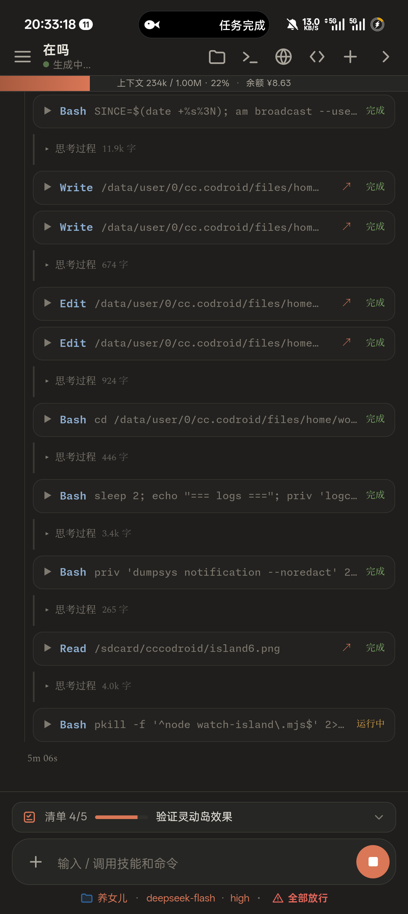
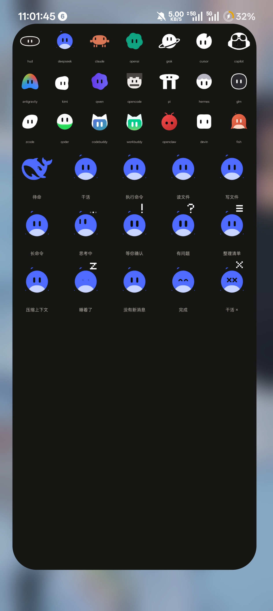
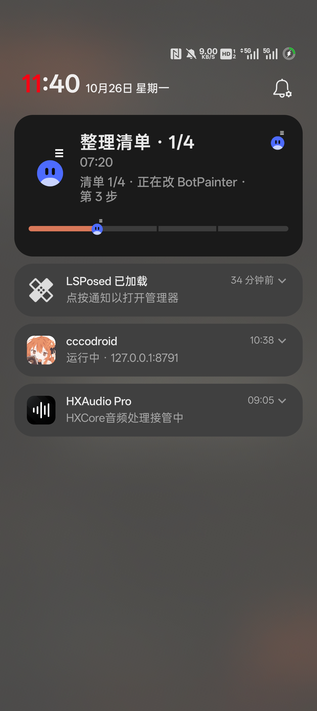
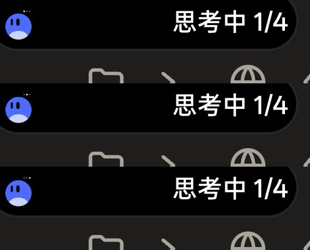
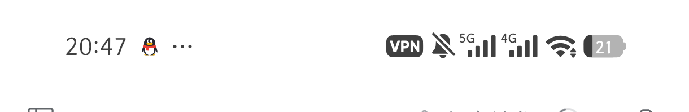
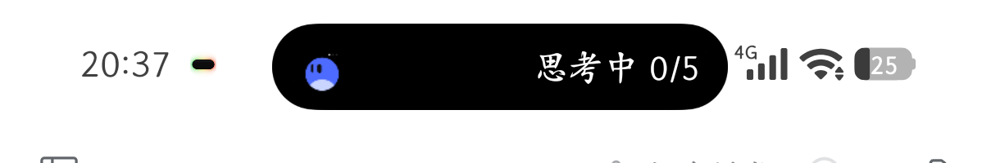
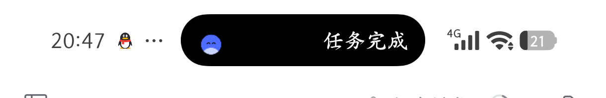

# 工作岛 · WorkIsland

> **本仓库是原项目 [`STUTTEFRFIX/WorkIsland-Android`](https://github.com/STUTTEFRFIX/WorkIsland-Android) 的 HyperOS 4 适配衍生版。**
> - 原作者：**STUTTEFRFIX（大肥鱼）**，原项目以 **Apache-2.0** 许可发布，本仓库保留同一许可与全部版权声明。
> - 本衍生版新增：HyperOS 4（小米超级岛 / Android 17）适配、本地 HTTP 桥、`dsh-work-island` DSHA 插件；
>   原有 ColorOS 流体云实现完整保留。
> - 第三方资源（Agent HUD、LobeHub 模型图标等）的许可与归属见 [`THIRD_PARTY.md`](THIRD_PARTY.md)、[`LICENSES/`](LICENSES/)。

> **测试状态：Pre-release / Alpha**
> 已在两种设备组合上测试成功：
> **OnePlus PJA110 · ColorOS 16.0.3 · Android 16（SDK 36）**，以及
> **Xiaomi 25113PN0EC · HyperOS 4.0.2 · Android 17（SDK 37）**（1.5 新增，见 [`docs/07-HyperOS4适配说明.md`](docs/07-HyperOS4适配说明.md)）。
> 其他版本与其他品牌均未验证；接口与文件布局可能继续变动，不建议用于生产或关键任务。
> 详细边界见 [`STATUS.md`](STATUS.md)。

把 **cccodroid 里 AI agent（DeepSeek / Claude 等）的实时工作状态**，投到 **ColorOS 16 的流体云** 或 **HyperOS 4 的小米超级岛**上。

- 干活时：胶囊标题跟着动作走——读文件 / 执行中 / 思考中 / 等确认；下面跟着更细的描述
- `TodoWrite` 任务清单会显示「清单 x/y」
- 收工：写「任务完成」+ 用时
- 8 秒后：岛上收起，通知栏只留一条安静的「工作岛 · 在后台等下一轮」
- **四态 bot**：Wakes / Works / Asks / Done；14 种 look、7 个头顶标识（`! ? ≡ × ⧗ … z`）
- **21 个模型**：每个 agent 有自己的形状、配色、眼睛，Claude 有手脚、DeepSeek 有肚子、Grok 有环、Cursor 缺一角、OpenClaw 有触须
- **可关**：设置里的「程序化 bot」开关关掉就退回旧的简笔图标
- **岛上不空**：折叠胶囊显示「思考中 1/4」这种状态 + 清单进度；ColorOS 展开后有计时、副标题和分段进度条
- **会动**：思考时头顶省略号逐帧跳、眼睛左右瞟、身体轻浮；每轮开始有 0.4 秒 logo→bot 的唤醒

不是另开一个任务清单，也不是模拟动画——数据直接来自 cccodroid 网关的真实事件流。

| 正在干活 | 任务完成 | 8 秒后收起 |
|---|---|---|
|  |  |  |

| 四态 bot（应用内预览） | 21 个模型 / 14 个 look | 通知里也带上标识 | 思考时的胶囊 |
|---|---|---|---|
|  |  |  |  |

更多截图见 `screenshots/`（含四态 bot、模型对照、岛上 `!` 标识、图标选择器），完整边界见 [`STATUS.md`](STATUS.md)，方案见 [`docs/01-方案与设计.md`](docs/01-方案与设计.md)。

**下载**：[Release 页面](https://github.com/STUTTEFRFIX/WorkIsland-Android/releases) · 1.4 的 APK 与 PDF 也在本仓库 `apk/`、`pdf/` 里。

---

## 交付物

| 路径 | 内容 |
|---|---|
| `apk/WorkIsland.apk` | 1.4 版 APK（ColorOS 测试版） |
| `apk/WorkIsland-hyperos.apk` | 1.5 版 APK（HyperOS 4 适配，同时兼容 ColorOS） |
| `source/app/` | Android 16 Live Update 应用源码（Java + 资源 + 构建脚本） |
| `source/driver/driver.mjs` | 独立状态驱动：0.4.2–0.4.6 的部署方式 |
| `source/gateway/work-island.mjs` | 0.4.2–0.4.6 的网关模块（spawn 独立 driver） |
| `source/gateway/server.mjs` | 0.4.2–0.4.6 已接入的网关入口（原文件见 `server.mjs.original`） |
| `source/upstream-pr/` | 上游 PR #21 合并版 + #22 跟进（网关内订阅 / 清单 / state / 单测 19 条） |
| `source/upstream-pr-review.patch` | 上游 PR #21 的完整 diff |
| `source/upstream-pr-review-22.patch` | 上游 PR #22（OPEN）的完整 diff |
| `screenshots/` | 工作态、完成态、收起、后台存活、应用界面截图 |
| `docs/` | 方案与设计、开发部署、测试报告、提交说明、开发过程与真机测试、状态与保活、**HyperOS 4 适配说明** |

APK 校验：

```
ColorOS 测试版（1.4）
SHA-256  98c6082527f4f349fd45b1f46c8de79e5e3dc82745099a62c47652627ba9bbb2
大小     338,665 字节

HyperOS 4 适配版（1.5.1 / versionCode 18）
SHA-256  46723384c86dc395fb477e1c8da3a2959db63c5d2581e8ac3cc41fab46782f7e
大小     346,861 字节
```

---

## HyperOS 4（小米超级岛）

1.5 起的适配结论（细节与实验记录见 [`docs/07-HyperOS4适配说明.md`](docs/07-HyperOS4适配说明.md)）：

- HyperOS 4 的超级岛直接接 AOSP promoted ongoing 通知：岛上显示 **`smallIcon` + `shortCriticalText`**。
- 不需要申请小米「超级岛」权限也能上岛；官方 `miui.focus.param`（大岛/小岛/息屏文案）**未鉴权时会被系统忽略**，
  代码里已预埋，将来拿到 APP_ID 即可启用。
- 岛上文案改成 `状态 + 进度`，例如 `执行中 2/5`、`思考中`、`任务完成`；分段进度条不上岛。
- 新增 `HyperOs` / `IslandPayload` 两个平台适配类，以及 HyperOS 专属的保活入口（自启动 / 省电策略 / 通知 / 电池优化）。
- `IslandService` 的 `startForeground()` 增加了降级：后台启动前台服务被系统拒绝时改用普通通知，仍可上岛。

| 干活（清单 2/5） | 思考 | 完成 | 8 秒后收起 |
|---|---|---|---|
|  |  |  |  |

---

## 在 DSHA（DeepSeek Harness Android）里用

工作岛原本靠 `am start-foreground-service` 驱动，而 DSHA 的设备命令通道不放行 `am`。
所以 1.5.1 起工作岛自己开了一个本地 HTTP 桥，配一个 DSHA 用户插件把状态推上去：

```bash
# 工作岛 App 在本机监听 127.0.0.1:8799（只绑本地，不需要 root/adb/Shizuku）
curl -s "127.0.0.1:8799/state?state=reading&text=Notifier.java&todoDone=2&todoTotal=5"
curl -s "127.0.0.1:8799/done?title=任务完成&text=用时 3 分"
```

插件 `dsh-work-island`（`source/dsha-plugin/`）有两层：

- **自动跟随（默认）**：监听 DSH 的 `session/event`，回合开始显示 `思考中`，工具调用显示
  `执行中 / 读文件 / 写文件 / 联网查`，清单更新显示 `执行中 2/5`，回合结束显示 `任务完成`——
  全程不需要模型手动推。
- **手动控制**：注册 `island` 工具，需要覆盖当前显示时才调用。

安装包在 `source/dsha-plugin/dsh-work-island-0.2.0.tar.gz`，`tools/island` 是给 shell 用的薄封装。

- 设计与安装步骤：[`docs/08-DSHA集成.md`](docs/08-DSHA集成.md)
- 不改 DSHA 任何文件：插件是用户插件，安装后重启一次 Web 生效

---

## 快速开始

1. 安装 `apk/WorkIsland.apk`。
2. 打开「工作岛」，确认三行状态：
   - 通知：开
   - 实时更新：允许
   - 电池：不优化
3. 接入网关：
   - **ccc odroid 0.4.7+**：设置 → 工作岛（ColorOS 灵动岛）→ 打开，重启一次网关。
   - **0.4.2–0.4.6**：按 `docs/02-开发与部署.md` 第 4 节接入独立 driver。
4. 在 cccodroid 里让 DeepSeek（或任意 agent）干一次活，看岛。

---

## 测试环境

| 项 | 值 |
|---|---|
| 设备 | OnePlus PJA110 / Xiaomi 25113PN0EC |
| 系统 | ColorOS 16.0.3（Android 16 / SDK 36）· HyperOS 4.0.2（Android 17 / SDK 37） |
| cccodroid | 0.4.2 |
| 网关 | 127.0.0.1:8791 |
| 应用 | com.dafeiyu.workisland 1.4（ColorOS）/ 1.5（HyperOS 4） |
| 构建 | aapt2 2.20-android-16 / d8 9.2.4 / apksigner 0.9 / javac 21 |
| 编译 SDK | Android 16 platform-36（android.jar） |

---

## 一句话设计

> **网关负责“知道”，模块负责“判断”，工作岛负责“画”。**
> 定时器和事件流不放在会被 ColorOS 冻结的应用里，放在网关进程里。

0.4.7 起上游改为进程内订阅（`onPublish` + `runList`），不再单独起 driver；本仓库的 `source/driver/` 是 0.4.2–0.4.6 的部署方式。两种方式发送给同一个应用。

详细设计见 [`docs/01-方案与设计.md`](docs/01-方案与设计.md)。

---

## 参考与致谢

- [jazzenchen/agent-hud-open](https://github.com/jazzenchen/agent-hud-open)
  （Apache-2.0）：四态 bot、14 look、7 个标识、BotSpec 与渲染几何的移植来源。
- [cccodroid](https://github.com/greyoak111/cccodroid)：网关事件流、终端与宿主能力。
- [LobeHub Icons](https://github.com/lobehub/lobe-icons)（MIT）：21 个模型图标；
  商标归各自所有者，非官方关联。

---

## 许可与第三方说明

本项目使用 **Apache-2.0**，见 [`LICENSE`](LICENSE)。

第三方图标与许可：Agent HUD 图标（Apache-2.0）、LobeHub 模型图标（MIT），
详见 [`THIRD_PARTY.md`](THIRD_PARTY.md) 与 [`LICENSES/`](LICENSES/)。

> 工作岛是**第三方应用的可选集成**：cccodroid 只负责把状态送出来，不包含也不负责本应用的功能。
